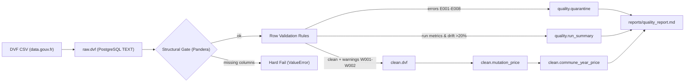

# DVF Quality Gate


An automated data quality gate and analytical pipeline for French property transactions (**DVF — Demandes de valeurs foncières géolocalisées**, scoped to **Department 91 — Essonne**) that validates untrusted open data before building analytical price-per-$\text{m}^2$ marts and publishing a quality audit report.

---

## Why This Project Exists

Most data pipelines silently propagate dirty records—missing sale values, duplicated multi-parcel prices, corrupted dates, or extreme outliers—straight into downstream dashboards. **DVF Quality Gate** combines software QA discipline with data engineering:
1. It lands raw data losslessly as untyped text so malformed records never crash ingestion.
2. It enforces a two-tier quality gate (structural schema validation + row-level error/warning rules) with an auditable JSON quarantine table and volume-drift detection.
3. It proves every validation rule works using a deterministic **synthetic dataset with injected defects** verified in CI.

---

## Architecture



---

## Quality Rules Specification

| Code | Severity | Description | Engineering & Domain Rationale |
| :--- | :--- | :--- | :--- |
| `E001` | `error` | Sale (`Vente`) without a transaction value | Cannot compute price metrics without `valeur_fonciere`; quarantined. |
| `E002` | `error` | Sale (`Vente`) with value $\le 0$ | Non-positive transaction prices are invalid for market sales. |
| `E003` | `error` | Unparseable or out-of-range mutation date | Rejects malformed dates, future dates, or records outside the DVF window ($< \text{2014-01-01}$). |
| `E004` | `error` | Commune INSEE code is not 5 characters | Prevents broken joins and invalid commune groupings in downstream marts. |
| `E005` | `error` | Postal code present but not 5 digits | Catches corrupted postal codes while tolerating nullable non-building parcels. |
| `E006` | `error` | Department code does not match target (`91`) | Prevents cross-department contamination during ingestion. |
| `E007` | `error` | Coordinates outside metropolitan France | Flags geocoding corruption ($\text{lat} \notin [41, 52]$ or $\text{lon} \notin [-6, 10]$). |
| `E008` | `error` | House or apartment without a positive surface | Residential units (`Maison`, `Appartement`) require `surface_reelle_bati > 0` for $\text{EUR/m}^2$. |
| `W001` | `warning` | Symbolic sale value ($0 < \text{value} \le 1\text{ EUR}$) | Kept in `clean.dvf` with warning flag (legitimate symbolic transfers exist), excluded from price mart. |
| `W002` | `warning` | Extreme transaction value ($> 50\text{ M EUR}$) | Retained in `clean.dvf` with warning flag for auditability of large institutional transfers. |

---

## Key Engineering Design Decisions

* **Text-Only Raw Layer (`raw.dvf`):** All columns are bulk-loaded via PostgreSQL `COPY` as `TEXT` alongside a surrogate `_row_id bigserial PRIMARY KEY`. This guarantees idempotency and ensures malformed strings never abort the database load before the validator can inspect and quarantine them.
* **Errors vs. Warnings & Quarantine Auditing:** Fatal data defects (`E001`–`E008`) exclude the row from `clean.dvf` and persist the original record as JSON in `quality.quarantine` with its `run_id` and `rule_code`. Suspicious but potentially legitimate transactions (`W001`, `W002`) remain in `clean.dvf` annotated in the `warnings` column.
* **Per-Mutation Deduplication (`clean.mutation_price`):** In DVF, a single real-estate transaction (`id_mutation`) often spans multiple rows (multiple lots, parcels, or outbuildings) with the total `valeur_fonciere` repeated on every row. Summing `valeur_fonciere` across rows would severely inflate prices. Our transformation takes `max(valeur_fonciere)` once per `id_mutation`, sums `surface_reelle_bati` across distinct residential rows, and excludes mixed mutations containing commercial premises or bare land.
* **Synthetic Defect Injection (`tests/synth.py`):** Rather than testing against static production snapshots that change twice a year, unit tests generate a 500-row synthetic fixture with known defects injected on disjoint rows and assert that the validator catches the exact expected count per rule.

---

## Repository Structure

```text
dvf-quality-gate/
├── .github/workflows/ci.yml
├── .env.example
├── .gitignore
├── Dockerfile
├── LICENSE
├── Makefile
├── README.md
├── docker-compose.yml
├── pyproject.toml
├── docs/
│   ├── architecture-decisions.md
│   ├── data-profile.md
│   ├── learning-log.md
│   └── project-progress.md
├── reports/
├── sql/mart.sql
├── src/dvf_gate/
│   ├── __init__.py
│   ├── db.py
│   ├── download.py
│   ├── ingest.py
│   ├── rules.py
│   ├── validate.py
│   ├── report.py
│   └── run.py
└── tests/
    ├── fixtures/dvf_synth.csv
    ├── synth.py
    ├── test_rules.py
    └── test_pipeline.py
```

---

## Quick Start

### Prerequisites
* Python 3.11+
* Docker & Docker Compose
* GNU Make

### Run Demo (Synthetic Fixture in Docker)
```bash
make demo
```

### Local Development & Testing
```bash
make db        # Start PostgreSQL 16 container
make install   # Install package and dev dependencies
make lint      # Run Ruff linter
make test      # Run unit and integration test suite
```

---

## Data Source & Privacy Note

* **Source:** [Demandes de valeurs foncières géolocalisées (data.gouv.fr)](https://www.data.gouv.fr/datasets/demandes-de-valeurs-foncieres-geolocalisees)
* **Privacy Compliance:** In accordance with DVF reuse conditions (preventing external search-engine indexing of raw personal property transaction records), **no raw DVF data is committed to this repository**. Only aggregated analytical metrics and synthetic test fixtures (`tests/fixtures/dvf_synth.csv`) are stored in version control.
